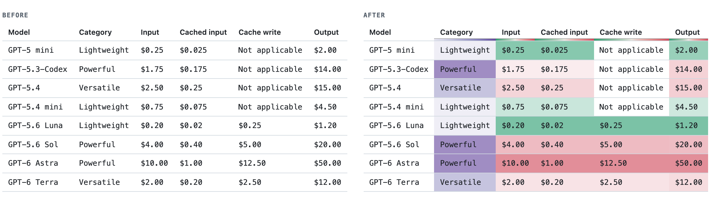
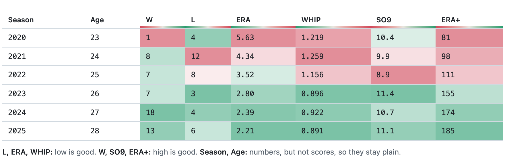
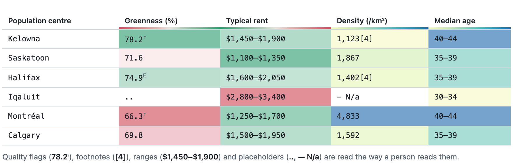
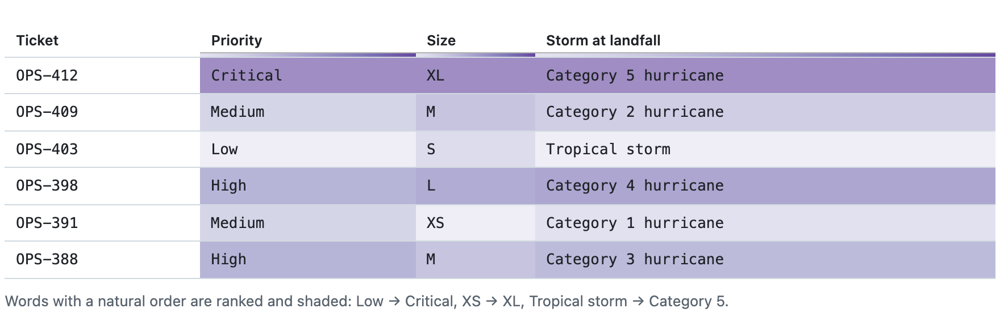
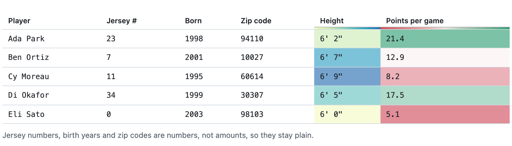

# Practical Data

Practical Data is a Chrome extension that shades the comparable columns of
HTML tables on any web page. A small decision model decides which columns to
shade and which end of each column is better. Code does all of the parsing,
arithmetic, and color work.

- Site and demo: https://practicaldata.dev
- Chrome Web Store: [Practical Data](https://chromewebstore.google.com/detail/practical-data/oeoogiokpnkhimnepeepflkpmghiokgm)
- License: [MIT](LICENSE)

<picture>
  <source media="(prefers-color-scheme: dark)" srcset="docs/media/hero-dark.png">
  
</picture>

## What leaves your browser

The extension sends table text to a decision model. It sends text only for
a table that comes within about one screen height of the viewport, on a site
where the extension is on. For each such table, it sends these items:

- The page title.
- The table's caption or nearest heading, and its column headers.
- Up to five sample values from each column, and the distinct labels in label
  columns.
- The first two and last two rows, to check whether they are totals.

It does not send the page URL, cookies, form contents, or text outside
tables. It sends nothing for tables that you never scroll near.

The receiver is the provider that you select on the options page:

- **Free** is the default from version 1.1.0. Requests go to
  `api.practicaldata.dev`, a Cloudflare Worker that the author runs. The
  Worker forwards the questions to TypeSafe's Jev model with the author's
  key. It also receives a random install id and your IP address. It keeps
  answers in Cloudflare's cache for 30 days, keyed by a hash of the request.
  It keeps a daily request count for each install id and deletes it after
  two days. It does not store the table text and does not log requests.
- **Jev** sends requests from your browser to `api.typesafe.ai` with your
  own TypeSafe key.
- **Clef** sends requests from your browser to `api.cloudflare.com` with
  your own Cloudflare account id and API token.

With your own key, the author receives nothing. The extension has no
analytics, telemetry, or crash reporting.

To keep a page's tables private, turn the site off in the toolbar popup.
You can also select **Only sites I turn on** on the options page, so that
the extension does nothing until you turn a site on. A site can opt out for
all users with `<meta name="practical-data" content="off">`.

[PRIVACY.md](PRIVACY.md) is the full privacy policy. The Worker's code is
in [src/api](src/api/README.md).

## Permissions

The manifest is [static/manifest.json](static/manifest.json). It asks for
these permissions:

- A content script on all `http` and `https` pages. The script reads tables
  from the page and paints the shading. Chrome shows this as access to your
  data on all websites.
- `storage`, for settings, your API key, the install id, and cached answers.
  All of these stay in the extension's storage on your device.
- `activeTab`, so that the toolbar popup can read the current tab's address
  and show the switch for that site.
- Host access to `api.practicaldata.dev`, `api.typesafe.ai`, and
  `api.cloudflare.com`, the three providers. The extension makes no other
  network requests.

Only the service worker and the extension's own pages read your API key.
The content script never reads settings, and web pages cannot read extension
storage. The service worker accepts messages only from this extension.

## Install

### From the Chrome Web Store

Install from the
[store listing](https://chromewebstore.google.com/detail/practical-data/oeoogiokpnkhimnepeepflkpmghiokgm).

Version 1.1.0 adds the free provider. It is submitted to the store and is
waiting for review. Until the store approves it, the store serves version
1.0.0, which needs your own key. To use 1.0.0, paste a TypeSafe API key on
the options page and select **Test**.

### From source

You need Node.js and npm.

```sh
npm ci
npm run build
```

1. Open `chrome://extensions` and turn on **Developer mode**.
2. Select **Load unpacked** and choose the `dist/` folder.
3. Optional: on the options page, select **Jev** or **Clef**, paste your
   own key, and select **Test**.

### Compare a build with the store copy

The build does not minify the code, so you can read the installed copy.
Each build writes the commit it came from into the manifest's
`version_name`, for example `1.1.0 (eb73f40, 2026-10-21 03:15)`. The
popup and the options page show this value as **Build**.

To compare a build with the store copy:

1. Read the commit hash from **Build** in the popup.
2. Check out that commit, then run `npm ci` and `npm run build`.
3. Compare `dist/` with the installed copy. Chrome keeps it in your
   profile's `Extensions/oeoogiokpnkhimnepeepflkpmghiokgm/` folder.

Two builds of one commit with the same `package-lock.json` give identical
files, so the JavaScript, HTML, and CSS are the files to compare.
`manifest.json` is different, because `version_name` holds the build time
and the store adds its own fields.

`npm run package` makes the store upload,
`release/practical-data-<version>.zip`. It refuses to run if `src/`,
`static/`, or the build script has uncommitted changes.

## What it shades

### Direction

Price, ERA, and errors are lower-is-better. Wins and strikeouts are
higher-is-better. When a column has a better direction, green is the better
end.

<picture>
  <source media="(prefers-color-scheme: dark)" srcset="docs/media/direction-dark.png">
  
</picture>

### Messy cells

The parser reads footnotes, quality flags, ranges, units, clock durations,
and placeholders. A range is shaded at its midpoint. `2:59` reads as one
second less than `3:00`, but a `7:05` start time stays plain. The table
below is an example made for the README.

<picture>
  <source media="(prefers-color-scheme: dark)" srcset="docs/media/messy-dark.png">
  
</picture>

### Ranked labels

Labels with a natural order are put in order and shaded. Examples are Low
to Critical, XS to XL, and Tropical storm to Category 5. The table below is
an example made for the README.

<picture>
  <source media="(prefers-color-scheme: dark)" srcset="docs/media/words-dark.png">
  
</picture>

### Identifiers stay plain

Jersey numbers, years, zip codes, and model names are not amounts, so they
stay plain. The table below is an example made for the README.

<picture>
  <source media="(prefers-color-scheme: dark)" srcset="docs/media/plain-dark.png">
  
</picture>

### Other behavior

- If the rows are the measures and the columns are the items, as in a
  benchmark table, each row gets its own scale.
- If the same column appears in several tables on a page, the tables share
  one scale.
- Totals and averages, such as "World" or "Total", are not part of the
  scale.
- If a column's values span a factor of 10 or more, the model decides
  whether it gets a log scale.
- Date columns shade from earliest to latest. Code reads the dates, so they
  need no model request.
- A rank column is shaded, unless it only counts the rows (1, 2, 3 down a
  sorted table).
- The palette comes from each cell's real background, including `oklch()`
  colors. Light and dark pages get separate palettes. Text keeps a contrast
  ratio of at least 5:1.
- A column is shaded only when the model gives it a probability of 0.7 or
  more.

## Use it

- Hover a shaded header to see its scale.
- Hover a table to switch it between columns and rows, or to hide its
  shading. These choices last for the browser session.
- Use the toolbar popup to turn the current page or site off.
- Press <kbd>⌥⇧H</kbd> to turn shading on or off for the current page.

The options page sets the provider, the palette, and where to shade (every
site, or only the sites you turn on). It also has a button that clears
cached answers.

## Cost

The free provider has a daily limit of 400 model requests for each install,
and a total daily budget for all installs. Answers in the shared cache do
not count against the limit. When the limit runs out, the toolbar icon shows
"!", and the popup says when the limit resets. To remove the limit, use your
own key.

With your own key, you pay the provider. An offline replay of the test
corpus sends 290 requests and 739,390 input tokens for 26 pages. At Jev's
price of $0.042 per million input tokens, that is about $0.03. The extension
caches answers, so it does not pay twice for an unchanged table.

## Known limitations

- The extension reads only HTML `<table>` elements. It does not read canvas
  charts or virtualized grids.
- It judges at most 200 tables on a page.
- Single-letter codes can get the wrong order. For card rarity (C, U, R, M),
  Jev puts M (mythic) below U and R.
- Heights written as `6-7` (feet and inches) are read as labels, not
  numbers. The order is correct, but the steps are not to scale.
- The model's answers can change between runs when a probability is near a
  threshold.
- With the free provider, the extension stops for the rest of the day when
  your install or the total budget reaches its limit.

## Development

| Command | What it does | Network |
| --- | --- | --- |
| `npm run build` | Builds the extension into `dist/` | None |
| `npm run dev` | Rebuilds `dist/` on each change | None |
| `npm test` | Unit tests: parsing, profiling, ordering, color math, contrast, and the judge against a scripted model | None |
| `npm run eval` | Asks the model about 26 pages and compares the answers with the hand labels in `fixtures/expectations.json` | Jev, for new questions only |
| `npm run eval -- --offline --strict` | Replays recorded answers from `fixtures/recordings/`. Fails on a mismatch not listed under `$known` | None |
| `npm run e2e -- --offline` | Loads the built extension in Chromium and checks painting, contrast, controls, the popup, and clean removal | None. API calls are replayed |
| `npm run e2e -- --live` | The same checks against the live sites in `fixtures/live/sources.json` | Jev |
| `npm run api:smoke` | Runs the free endpoint under `wrangler dev` against a stand-in for TypeSafe | None |
| `npm run check` | Runs format check, type check, unit tests, build, offline eval, and offline e2e | None |
| `npm run package` | Builds the store zip into `release/` | None |

[test/README.md](test/README.md) and [scripts/README.md](scripts/README.md)
describe the tests and scripts. To see why a column on a page was or was not
shaded, run `node scripts/explain-url.ts <url>`.

### What the scores mean

`fixtures/expectations.json` holds hand labels for 285 columns on 26 pages.
The labels and the thresholds were tuned on these same pages. The scores are
therefore a regression check, not an accuracy estimate for new pages. The
offline replay tests the code against recorded answers. It does not test
the model. To ask the model again, run `npm run eval` without `--offline`.

Offline replay with Jev 1.13 at this commit:

```
color / don't color   284 of 285
polarity              156 of 156
log vs linear          23 of 23
ordinal order          12 of 13
aggregate rows          4 of 4
shared scales          10 of 11
rows vs columns         7 of 7
```

Each miss is listed with its reason under `$known` in
`fixtures/expectations.json`.

To compare providers, set `CLOUDFLARE_ACCOUNT_ID` and
`CLOUDFLARE_API_TOKEN`, then run `node scripts/eval.ts --provider clef`.

### Site

`web/` is the site at practicaldata.dev, a SvelteKit app. It shades real
tables from the test corpus with the extension's own extractor and painter,
and replays recorded answers. `/tests` shows each labeled check on its
table. Each push to `main` deploys the site. [web/README.md](web/README.md)
has the details.

## Repository layout

| Path | Contents |
| --- | --- |
| [src/dom](src/dom/README.md) | Reads tables from the page and paints the shading |
| [src/core](src/core/README.md) | Pure code: cell parsing, column profiles, ordering, color scales, contrast |
| [src/decide](src/decide/README.md) | Questions for the model, the judge, and the provider transports |
| [src/ext](src/ext/README.md) | Content script, service worker, popup, options page, and settings |
| [src/api](src/api/README.md) | The free endpoint, a Cloudflare Worker |
| [scripts](scripts/README.md) | Build, package, eval, e2e, and screenshot scripts |
| [test](test/README.md) | Unit tests |
| [web](web/README.md) | The site at practicaldata.dev |
| `fixtures/` | Saved pages, hand labels, extractor snapshots, and recorded answers |
| `static/` | Manifest, icons, fonts, and the popup and options HTML |

[docs/architecture.md](docs/architecture.md) is a one-page map of how a
table goes from the page to the model and back.

## License

[MIT](LICENSE). The pages in `fixtures/live/` belong to their publishers.
They are trimmed to their tables and included only as test inputs. See
[fixtures/NOTICE.md](fixtures/NOTICE.md).
