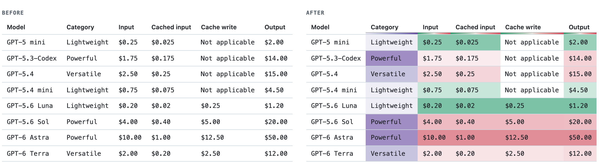
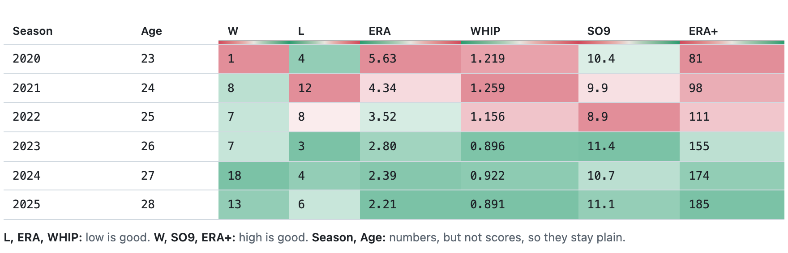
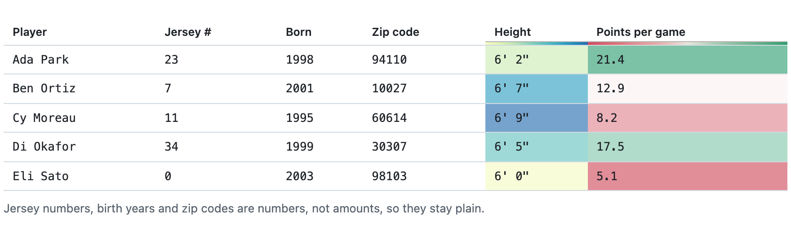
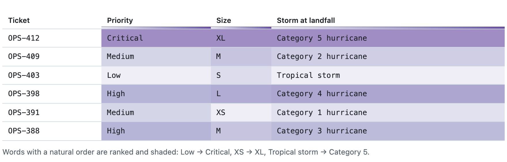
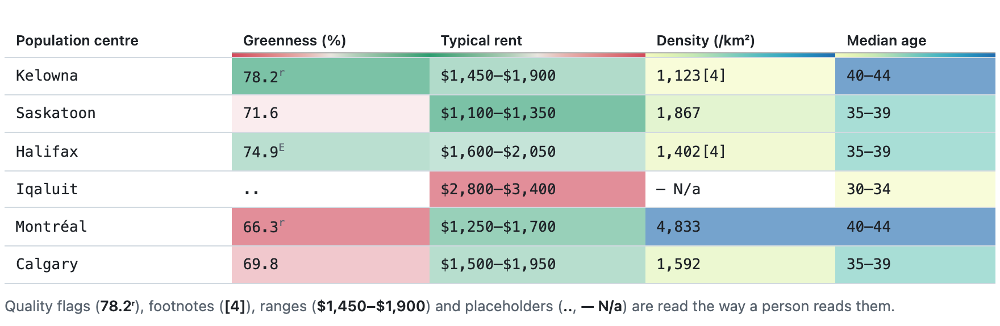

# Practical Data

**Every table on the web becomes a data visualization.**

Practical Data is a Chrome extension that applies conditional formatting to
data tables as you browse. It does the tricky stuff automatically, like
figuring out which direction is "better" or how to read messy cells, using a
small decision model.

[Add to Chrome](https://chromewebstore.google.com/detail/practical-data/oeoogiokpnkhimnepeepflkpmghiokgm)
· [Try it on real tables](https://practicaldata.dev)
· [Docs and tests](https://practicaldata.dev/tests)
· [About this project](https://practicaldata.dev/about)

<picture>
  <source media="(prefers-color-scheme: dark)" srcset="docs/media/hero-dark.png">
  
</picture>

It's free, it works without a key, and it's open source (MIT).

## What it does

Spreadsheets have had conditional formatting forever, but somebody has to
set it up: pick the columns, say which end is good. On a web page nobody has
done that for you. Practical Data asks a model the questions you would have
answered, and code does the rest.

### Figures out which direction is better

If I shaded every column in this table with a uniform "big numbers = green"
rule, it would go against the meaning of a few of them (losses, and ERA is
better when it's lower). The model picks the direction for each column,
given its title and context.

<picture>
  <source media="(prefers-color-scheme: dark)" srcset="docs/media/direction-dark.png">
  
</picture>

### Knows which numbers are amounts

A lot of numbers aren't amounts. If you shade everything numeric, things
like jersey numbers and zip codes look like they're on a scale. Practical
Data asks the model whether a column is really a measure first, so
identifiers stay plain.

<picture>
  <source media="(prefers-color-scheme: dark)" srcset="docs/media/plain-dark.png">
  
</picture>

### Puts labels in order

Works on words, not just numbers! The model can put labels in order when an
order is implied, like Low to Critical, XS to XL, or Tropical storm to
Category 5.

<picture>
  <source media="(prefers-color-scheme: dark)" srcset="docs/media/words-dark.png">
  
</picture>

### Reads messy cells

Data on the web is messy in inconsistent ways. The parser reads through
footnotes, quality flags, ranges, units, and placeholders. A range shades at
its midpoint. `2:59` is one second less than `3:00`, but a `7:05` start time
stays plain.

<picture>
  <source media="(prefers-color-scheme: dark)" srcset="docs/media/messy-dark.png">
  
</picture>

I made up the last three tables for this README. The
[site](https://practicaldata.dev) shades real ones.

### And a handful of other things

- Notices when a table is meant to be read row-wise. In a benchmark table,
  each row is a measure and each column is an item, so each row gets its own
  scale.
- Ignores Total and Average rows, so "World" doesn't flatten every country
  under it.
- Lets same-named columns in several tables on a page share one scale.
- Knows when to use a log scale. When a column's values span a factor of 10
  or more, the model decides whether ratios matter more than differences.
- Shades dates from earliest to latest. Code reads the dates, so they need
  no model request.
- Shades a rank column, unless it only counts the rows (1, 2, 3 down a
  sorted table).
- Blends colour over each cell's real background, `oklch()` included. Light
  and dark pages get separate palettes, and text keeps a contrast ratio of
  at least 5:1.
- Leaves a column alone unless the model gives it a probability of 0.7 or
  more.

Each of these has a page of worked examples under
[practicaldata.dev/tests](https://practicaldata.dev/tests).

## How it works (TLDR)

1. **Read the page.** When you scroll a table into view, the extension
   figures out if it's got data or not. If it does, code standardizes the
   values (for parsing; your view of the page doesn't change). Things like
   `$0.025`, `.312`, `6' 6"`, `1.5B`, `$50–60K`, `2:59`, and `≤ 272K`.
2. **Reason about the data.** A System One model
   ([Jev](https://typesafe.ai)) answers narrow questions with
   probabilities:
   - Is this column an amount? An identifier? A timestamp? A rank?
   - Is a higher value better, worse, or neither?
   - Does it make sense to show it in linear or log scale?
   - Is this row a total, or part of the data?
   - Do same-named columns in other tables share a scale?
   - Are values compared down each column, or across each row?
3. **Paint the table.** The extension uses D3 to map each value onto a
   colour scale and applies it over the page's own background.

Code does all of the parsing, arithmetic, and colour work. The model only
answers questions about what things mean.
[docs/architecture.md](docs/architecture.md) follows one table from the page
to the model and back, and [docs/decisions.md](docs/decisions.md) is a bit
about how the questions are designed, and what the probes showed.

## Install

1. Install
   [Practical Data from the Chrome Web Store](https://chromewebstore.google.com/detail/practical-data/oeoogiokpnkhimnepeepflkpmghiokgm).
   The store serves version 1.3.0.
2. It works without a key. To use your own, paste a
   [TypeSafe](https://typesafe.ai) or
   [Clef](https://developers.cloudflare.com/workers-ai/models/clef/) API key
   on the options page.

Then go read something with a table in it.

- Hover a shaded header to see its scale.
- Hover a table to get its bar. From there you can switch between columns
  and rows, sort, copy the table as CSV, hide the shading, or tell me it
  looks wrong. Orientation and hiding last for the browser session.
- The toolbar popup turns the current page or a whole site off.
  <kbd>⌥⇧H</kbd> pauses the current page.
- The options page sets the provider, the palette, and where to shade (every
  site, or only the sites you turn on). It also clears cached answers.

## What leaves your browser

To judge a table, the extension has to show some of it to a model. It does
that only for a table that comes within about one screen of the viewport, on
a site where the extension is on. For each such table, it sends:

- The page title.
- The table's caption or nearest heading, and its column headers.
- Up to five sample values from each column, and the distinct labels in
  label columns.
- The first two and last two rows, to check whether they are totals.

It does not send the page URL, cookies, form contents, or text outside
tables. It sends nothing for tables you never scroll near.

Who receives it depends on the provider you pick on the options page:

- **Free** is the default. Requests go to `api.practicaldata.dev`, a
  Cloudflare Worker that I run. It forwards the questions to TypeSafe's Jev
  model with my key. It also receives a random install id and your IP
  address. It keeps answers in Cloudflare's cache for 30 days, keyed by a
  hash of the request, and a daily request count for each install id, which
  it deletes after two days. It does not store the table text and does not
  log requests.
- **Jev** sends requests from your browser straight to `api.typesafe.ai`
  with your own TypeSafe key.
- **Clef** sends requests from your browser straight to
  `api.cloudflare.com` with your own Cloudflare account id and API token.

With your own key, I receive nothing. The extension has no analytics,
telemetry, or crash reporting.

To keep a page's tables private, turn the site off in the toolbar popup. You
can also select **Only sites I turn on** on the options page, so the
extension does nothing until you turn a site on. A site can opt out for
everyone with `<meta name="practical-data" content="off">`.

[PRIVACY.md](PRIVACY.md) is the full privacy policy, and the Worker's code
is in [src/api](src/api/README.md).

### Permissions

The manifest is [static/manifest.json](static/manifest.json). It asks for:

- A content script on all `http` and `https` pages, which reads tables and
  paints the shading. Chrome describes this as access to your data on all
  websites.
- `storage`, for settings, your API key, the install id, and cached answers.
  These stay in the extension's storage on your device.
- `activeTab`, so the toolbar popup can read the current tab's address and
  show the switch for that site.
- `clipboardWrite`, for Copy CSV. It writes to the clipboard and never reads
  it.
- Host access to `api.practicaldata.dev`, `api.typesafe.ai`, and
  `api.cloudflare.com`, the three providers. The extension makes no other
  network requests.

Only the service worker and the extension's own pages read your API key. The
content script never reads settings, web pages cannot read extension
storage, and the service worker accepts messages only from this extension.

## Cost

System One models are pretty cheap :)

Replaying my whole test corpus sends 469 requests and 1,063,714 input tokens
for 57 pages. At Jev's price of $0.042 per million input tokens, that's
about 4 cents. A typical page costs about a tenth of a cent, and answers are
cached, so an unchanged table never costs twice.

The free provider runs on my key, so it has a daily limit: 400 model
requests for each install, and a total budget across all installs. Cached
answers don't count. When the limit runs out, the toolbar icon shows "!" and
the popup says when it resets. With your own key, I don't limit anything.

## Known limitations

These are the mistakes I know about. Most of them are cases where a fix
would break some other rule.

- It reads only HTML `<table>` elements, not canvas charts or virtualized
  grids.
- It judges at most 200 tables on a page.
- Heights written as `6-7` (feet and inches) look like ranges to the range
  rule, so they are read as labels. The order comes out right, but the steps
  are not to scale.
- Single-letter codes can get the wrong order. For card rarity (C, U, R, M),
  Jev puts M (mythic) below U and R.
- The model's answers can change between runs when a probability sits near
  a threshold.
- With the free provider, shading stops for the rest of the day when your
  install or the total budget reaches its limit.

[practicaldata.dev/tests/limitations](https://practicaldata.dev/tests/limitations)
shows each one on the table where I found it. If you find another,
[tell me about the table](https://github.com/philrenaud/practical-data/issues/new?template=wrong-shading.yml).

## Build it yourself

You need Node.js and npm.

```sh
npm ci
npm run build
```

1. Open `chrome://extensions` and turn on **Developer mode**.
2. Select **Load unpacked** and choose the `dist/` folder.
3. On the options page, select **Jev** or **Clef**, paste your own key, and
   select **Test**. The free endpoint accepts only the store build, so an
   unpacked build needs a key.

`npm run build:dev` builds a copy for field testing that can flag the tables
it gets wrong. See [src/ext/README.md](src/ext/README.md#flags-dev-build-only).

### Check the store copy against the source

You shouldn't have to take my word for what the store copy does. The build
doesn't minify, so you can read the installed code, and each build writes
the commit it came from into the manifest's `version_name`, for example
`1.1.0 (eb73f40, 2026-10-21 03:15)`. The popup and the options page show
this as **Build**.

1. Read the commit hash from **Build** in the popup.
2. Check out that commit, then run `npm ci` and `npm run build`.
3. Compare `dist/` with the installed copy. Chrome keeps it in your
   profile's `Extensions/oeoogiokpnkhimnepeepflkpmghiokgm/` folder.

Two builds of one commit with the same `package-lock.json` give identical
JavaScript, HTML, and CSS. `manifest.json` differs, because `version_name`
holds the build time and the store adds its own fields.

`npm run package` makes the store upload,
`release/practical-data-<version>.zip`. It refuses to run if `src/`,
`static/`, or the build script has uncommitted changes.

## Development

Every model answer the tests need is recorded in the repo, so almost
everything runs offline and without a key.

| Command | What it does | Network |
| --- | --- | --- |
| `npm run build` | Builds the extension into `dist/` | None |
| `npm run dev` | Rebuilds `dist/` on each change | None |
| `npm test` | Unit tests: parsing, profiling, ordering, color math, contrast, and the judge against a scripted model | None |
| `npm run eval` | Asks the model about 57 pages and compares the answers with the hand labels in `fixtures/expectations.json` | Jev, for new questions only |
| `npm run eval -- --offline --strict` | Replays recorded answers from `fixtures/recordings/`. Fails on a mismatch not listed under `$known` | None |
| `npm run e2e -- --offline` | Loads the built extension in Chromium and checks painting, contrast, controls, the popup, and clean removal | None. API calls are replayed |
| `npm run e2e -- --live` | The same checks against the live sites in `fixtures/live/sources.json` | Jev |
| `npm run api:smoke` | Runs the free endpoint under `wrangler dev` against a stand-in for TypeSafe | None |
| `npm run check` | Runs format check, type check, unit tests, build, offline eval, and offline e2e | None |
| `npm run package` | Builds the store zip into `release/` | None |

[test/README.md](test/README.md) and [scripts/README.md](scripts/README.md)
describe the tests and scripts, and [CONTRIBUTING.md](CONTRIBUTING.md) says
what a pull request needs. To see why a column on some page was or wasn't
shaded, run `node scripts/explain-url.ts <url>`.

### What the scores mean

I copied tables from public pages while building this and hand-labelled
their columns: 563 columns on 57 pages, in `fixtures/expectations.json`. I
tuned the labels and the thresholds on those same pages. So the scores are a
regression check, not an accuracy estimate for pages the tool has never
seen.

The offline replay tests the code against recorded answers. It does not test
the model. To measure model drift, follow the steps in
[scripts/README.md](scripts/README.md).

Offline replay at this commit, from answers recorded with Jev 1.13 and 1.14:

```
color / don't color   561 of 563
polarity              275 of 275
log vs linear          27 of 27
ordinal order          15 of 16
aggregate rows         15 of 15
shared scales          10 of 11
rows vs columns        10 of 10
```

Each miss is listed with its reason under `$known` in
`fixtures/expectations.json`.

To compare providers, set `CLOUDFLARE_ACCOUNT_ID` and
`CLOUDFLARE_API_TOKEN`, then run `node scripts/eval.ts --provider clef`.

### Site

`web/` is the site at practicaldata.dev, a SvelteKit app. It shades real
tables from the test corpus with the extension's own extractor and painter,
and replays recorded answers. `/tests` shows each labelled check on its
table. Each merge to `main` deploys the site. [web/README.md](web/README.md)
has the details.

### Repository layout

| Path | Contents |
| --- | --- |
| [src/dom](src/dom/README.md) | Reads tables from the page and paints the shading |
| [src/core](src/core/README.md) | Pure code: cell parsing, column profiles, ordering, color scales, contrast |
| [src/decide](src/decide/README.md) | Questions for the model, the judge, and the provider transports |
| [src/ext](src/ext/README.md) | Content script, service worker, popup, options page, and settings |
| [src/api](src/api/README.md) | The free endpoint, a Cloudflare Worker |
| [scripts](scripts/README.md) | Build, package, eval, e2e, and screenshot scripts |
| [test](test/README.md) | Unit tests |
| [web](web/README.md) | The site at practicaldata.dev |
| `fixtures/` | Saved pages, hand labels, extractor snapshots, and recorded answers |
| `static/` | Manifest, icons, fonts, and the popup and options HTML |

## About

I'm [Phil Renaud](https://philrenaud.com), and I started Practical Data in
October 2026.

> We now have access to more information than we can reasonably be expected
> to understand on its own. We owe it to ourselves to build tools to make
> sense of it, if we don't want to cede the task of understanding to AI.

There's a little more on the
[about page](https://practicaldata.dev/about).

## Colophon

- [Jev](https://typesafe.ai), by TypeSafe, is the decision model.
- [Clef](https://developers.cloudflare.com/workers-ai/models/clef/), by
  Cloudflare, is the other one you can bring a key for.
- [D3](https://d3js.org/) does the scales and the colour math.
- The palettes are [ColorBrewer](https://colorbrewer2.org/) schemes, by
  Cynthia Brewer.
- The free endpoint and the site run on Cloudflare Workers.

## License

[MIT](LICENSE). The pages in `fixtures/live/` belong to their publishers.
They are trimmed to their tables and included only as test inputs. See
[fixtures/NOTICE.md](fixtures/NOTICE.md).
